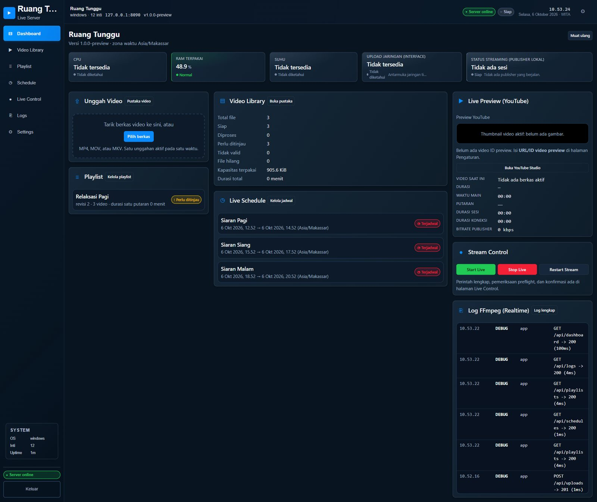
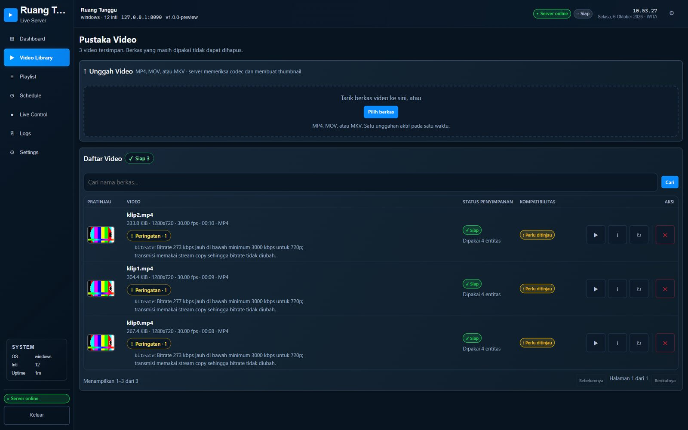
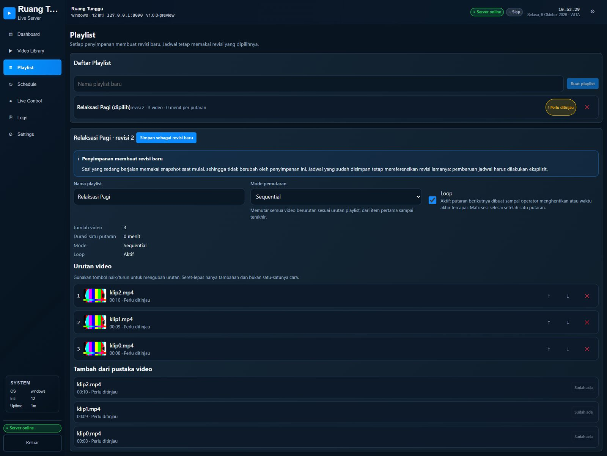
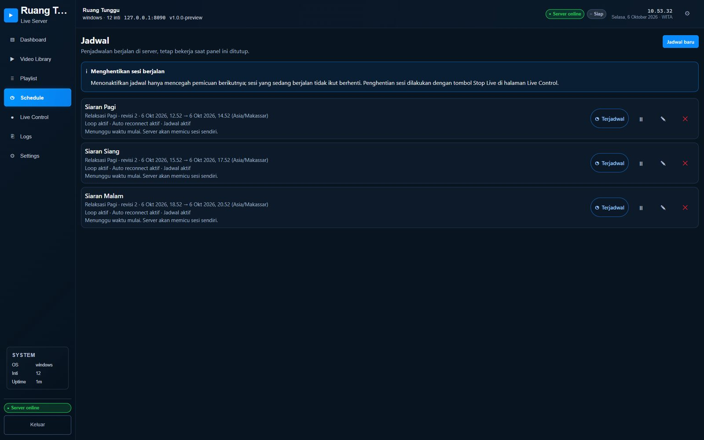
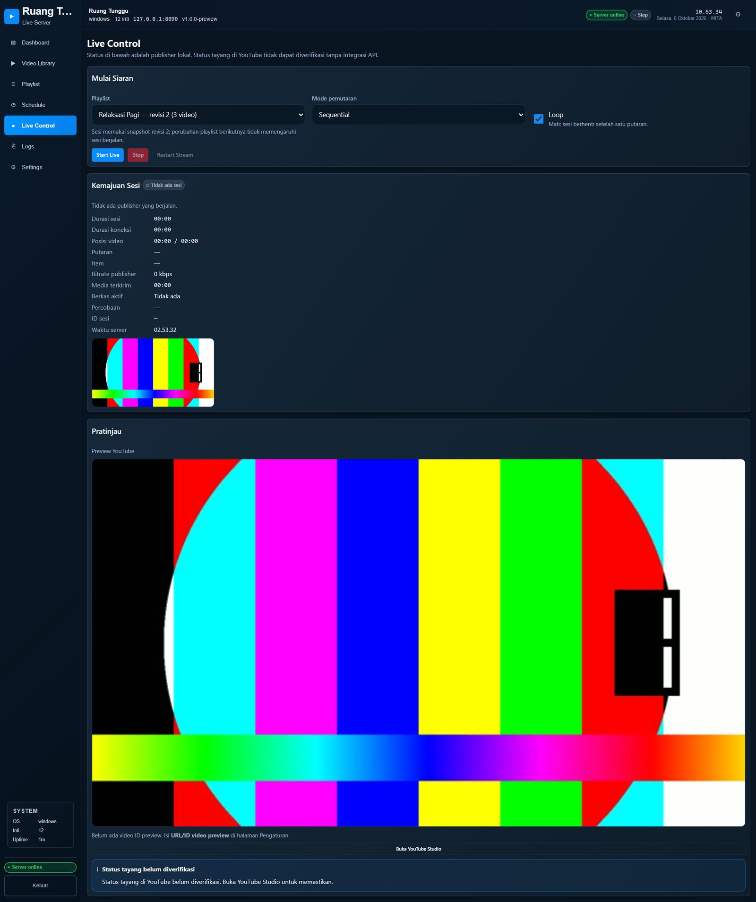
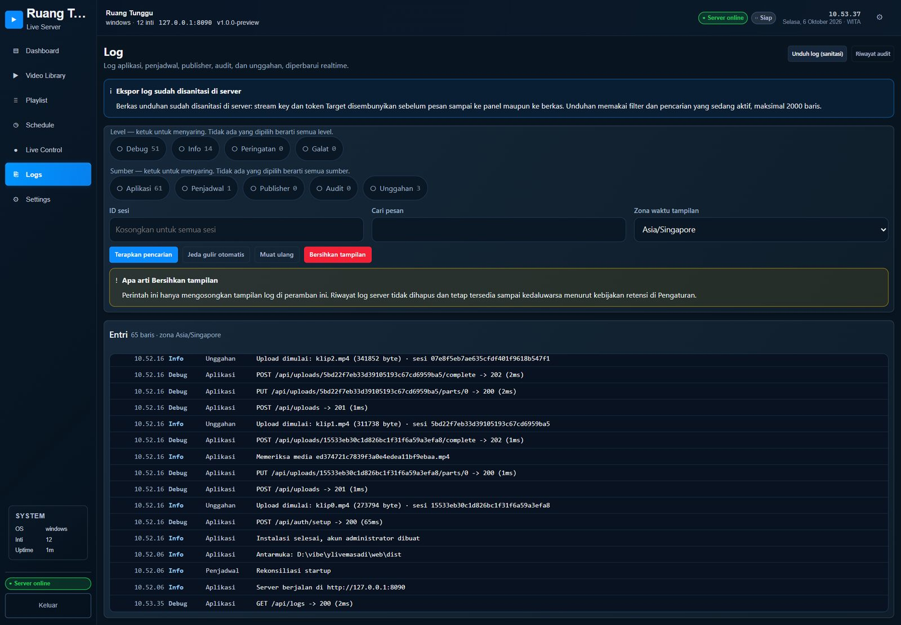
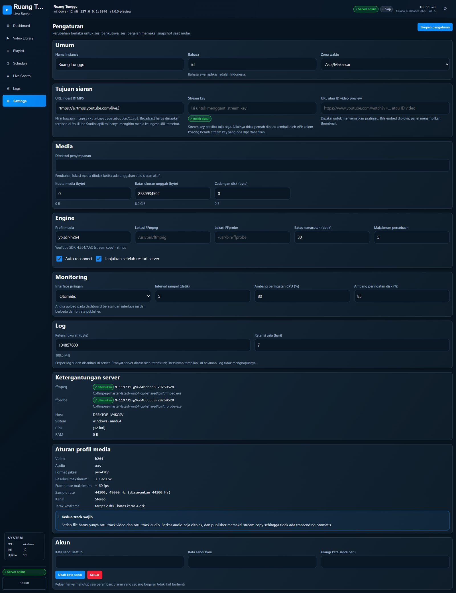
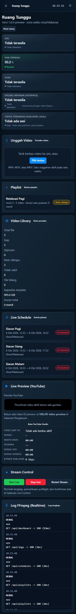

# YouTube Live Server

Aplikasi web self-hosted untuk menyiarkan video yang tersimpan di server ke YouTube
lewat **RTMPS** dengan mode **stream copy** FFmpeg — tanpa transcoding, sehingga
perangkat kecil 2 GB masih sanggup menjalankan siaran.

Unggah video dari browser, susun playlist, jadwalkan siaran, lalu jalankan. Server
terus berjalan meski browser ditutup, logout, atau komputer dimatikan.



---

## Daftar isi

- [Kemampuan](#kemampuan)
- [Tangkapan layar](#tangkapan-layar)
- [Cara kerja](#cara-kerja)
- [Kebutuhan sistem](#kebutuhan-sistem)
- [Build](#build)
- [Jalankan](#jalankan)
- [Service systemd](#service-systemd)
- [Penyiapan di YouTube Studio](#penyiapan-di-youtube-studio)
- [Kebutuhan media](#kebutuhan-media)
- [Keamanan](#keamanan)
- [Catatan operasional](#catatan-operasional)
- [Pengembangan](#pengembangan)
- [Struktur proyek](#struktur-proyek)

---

## Kemampuan

| Modul | Isi |
|---|---|
| Dashboard | Lima kartu pemantauan, tujuh panel ringkas, grafik riwayat 15 menit |
| Video Library | Unggah bertahap dengan seolah, thumbnail, validasi kompatibilitas, pencarian, paginasi |
| Playlist | Tiga mode pemutaran, loop, susun ulang, revisi, deteksi ketidakcocokan antar berkas |
| Schedule | Jadwal sekali jalan dengan zona waktu IANA, deteksi bentrok, status delapan tahap |
| Live Control | Preflight, start/stop/restart, pemantau posisi, pratinjau YouTube, log realtime |
| Logs | Filter level dan sumber, pencarian, jeda autoscroll, ekspor tersanitasi |
| Settings | Sembilan kelompok pengaturan, termasuk lokasi FFmpeg dan kebijakan pemulihan |

Yang **tidak** termasuk P0 dan sengaja ditunda: integrasi API YouTube, lebih dari
satu sesi serentak, konversi video, dan kamera langsung.

---

## Tangkapan layar

| Halaman | Tangkapan |
|---|---|
| Dashboard |  |
| Video Library |  |
| Playlist |  |
| Schedule |  |
| Live Control |  |
| Logs |  |
| Settings |  |
| Tampilan ponsel (360 px) |  |

---

## Cara kerja

Satu binary Go melayani antarmuka dan API, ditambah FFmpeg untuk medal media.

```
cmd/ytliveserver      titik masuk
internal/
  app         penyambungan komponen, siklus hidup proses, perawatan berkala
  api         rute HTTP, middleware autentikasi/CSRF, pusat SSE
  auth        kata sandi argon2id, sesi, pembatasan percobaan login
  config      flag dan variabel lingkungan
  jobs        antrean media: probe → validasi → thumbnail
  logging     log berotasi, redaksi kredensial, distribusi SSE dan basis data
  media       pembungkus ffprobe/ffmpeg, validator profil pengiriman
  monitoring  sampel CPU/RAM/suhu/jaringan/disk
  repo        akses data SQLite
  scheduler    pemicu berbasis jam, rekonsiliasi saat start
  secrets     enkripsi AES-GCM untuk stream key
  store       skema dan migrasi
  streaming   worker publisher: preflight, playlist, percobaan ulang, shutdown
web/          React + TypeScript + Vite
```

Worker memiliki **satu-satunya slot publisher**. Maksimal satu sesi berjalan
sekaligus, dan hanya worker yang boleh memulai proses media.

### Pipa media

Satu proses FFmpeg per sesi:

```
-f concat -safe 0 -i playlist.txt   # durasi eksplisit tiap entri
  -re                                # laju waktu nyata
  -map 0:v:0 -map 0:a:0
  -c:v copy -c:a copy                # stream copy, tanpa decode
  -bsf:a aac_adtstoasc
  -rw_timeout 15000000
  -f flv rtmps://…
```

Concat demuxer membuka dan menutup tiap berkas input secara internal, sehingga
muxer FLV dan koneksi RTMPS dibuat **sekali** dan tidak pernah terputus di batas
berkas. Saat loop aktif, `-stream_loop -1` mengulang input yang sama, jadi koneksi
tujuan juga bertahan lintas putaran.

- `-progress pipe:1` menggerakkan detektor macet: waktu media yang tidak maju
  selama 30 detik dianggap koneksi tersendat.
- `SIGINT` → tunggu 8 detik → `SIGKILL`. FFmpeg memetakan SIGINT dan SIGTERM ke
  handler yang sama, yaitu menguras muxer dan mengirim `FCUnpublish` agar YouTube
  mencatat akhir siaran dengan rapi.

---

## Kebutuhan sistem

Targetnya **Linux** (amd64, arm64, armv7). Windows dan macOS bisa dipakai untuk
pengembangan, tetapi pembacaan `/proc`, sensor, dan signalling process group
berkurang di sana.

- **FFmpeg dan FFprobe** di `PATH`, atau tentukan lokasi di Settings
- Go 1.27+ dan Node 20+ untuk membangun
- Tanpa cgo: SQLite murni Go, jadi cross-compile tidak butuh toolchain tambahan

---

## Build

```bash
make build-linux      # binary Linux native -> ./ytliveserver
make release          # semua target -> dist/
make help             # daftar target
```

Tanpa `make`:

```bash
cd web && npm ci && npm run build && cd ..
CGO_ENABLED=0 GOOS=linux GOARCH=amd64 go build -trimpath \
  -ldflags "-s -w -X main.version=1.0.0" -o ytliveserver ./cmd/ytliveserver
```

| `GOARCH` | Keluaran | Host biasa |
|---|---|---|
| `amd64` | `ytliveserver-linux-amd64` | VPS |
| `arm64` | `ytliveserver-linux-arm64` | ARM SBC, VPS |
| `arm` (`GOARM=7`) | `ytliveserver-linux-armv7` | papan ARM lama |

Masing-masing binary ELF statis sekitar 11–12 MB tanpa dependensi runtime selain
libc. Periksa cap build dengan `./ytliveserver -version`.

Salin `web/dist` di samping binary, atau arahkan `-frontend` ke lokasi itu.

---

## Jalankan

```bash
./ytliveserver -addr 0.0.0.0:8080 -data /var/lib/ytlive -media /mnt/media/videos
```

Buka `http://<server>:8080`. Kunjungan pertama menjalankan penyiapan: buat akun
administrator, atur zona waktu dan lokasi penyimpanan, lalu tempel URL ingest RTMPS
dan stream key dari YouTube Studio.

| Flag | Baku | Guna |
|---|---|---|
| `-addr` | `0.0.0.0:8080` | alamat bind |
| `-data` | `./data` | basis data, berkas kunci, log |
| `-media` | `<data>/media` | penyimpanan video, boleh volume terpasang |
| `-frontend` | `./web/dist` | frontend hasil build |
| `-secure-cookies` | `false` | aktifkan di belakang HTTPS |
| `-max-file-size` | 8 GiB | batas ukuran unggah |
| `-media-quota` | `0` (tak terbatas) | anggaran media total |
| `-disk-reserve` | otomatis | ruang kosong yang dijaga; otomatis = max(1 GiB, 5%) |
| `-resume` | `true` | lanjutkan sesi terputus setelah restart |

Setiap flag punya padanan variabel lingkungan (`YTL_ADDR`, `YTL_DATA_DIR`, …).

---

## Service systemd

```ini
[Unit]
Description=YouTube Live Server
After=network-online.target

[Service]
Type=simple
User=ytlive
ExecStart=/usr/local/bin/ytliveserver -data /var/lib/ytlive -media /mnt/media/videos
Restart=on-failure
RestartSec=5
# Publisher butuh jaringan dan volume media yang bisa ditulis; tidak lebih.
NoNewPrivileges=true
PrivateTmp=true
ProtectSystem=strict
ReadWritePaths=/var/lib/ytlive /mnt/media

[Install]
WantedBy=multi-user.target
```

Jalankan sebagai pengguna sistem khusus tanpa hak root. Stream key diteruskan ke
FFmpeg di dalam URL keluaran, jadi ia muncul pada argumen proses tersebut —
siapa pun yang bisa membaca `/proc` di mesin itu bisa memperoleh kunci Anda.
Batasi akses OS ke service.

---

## Penyiapan di YouTube Studio

Aplikasi hanya mengirim media. Siapkan acara secara terpisah di
**YouTube Studio → Create → Go live**:

1. Salin **stream key** dan URL ingest RTMPS ke Settings.
2. Aktifkan **automatic start** supaya acara tayang otomatis saat data mengalir —
   tanpa itu, koneksi ulang tidak akan menghidupkan t)!
3. Matikan **automatic stop** untuk siaran panjang. Jika aktif, acara berakhir
   sekitar semenit setelah encoder berhenti, sehingga jendela reconnect yang lebih
   lama dari itu kehilangan acara.
4. Opsional: tempel ID video ke Settings untuk pratinjau sematan.

Siaran lebih dari 12 jam mungkin tidak diarsipkan, dan kemampuan DVR menurun
seiring memorandum. Aplikasi tidak membatasi panjang sesi; itu batas sisi
YouTube.

---

## Kebutuhan media

Profil pengiriman — H.264 + AAC, stream copy saja:

| Sifat | Syarat |
|---|---|
| Codec video | H.264, pixel format `yuv420p` |
| Codec audio | AAC |
| Resolusi | sampai 1920 px sisi terpanjang |
| Frame rate | sampai 60 fps |
| Audio | 44,1 kHz yang disukai (48 kHz diterima), stereo |
| Track | **tepat satu video dan satu audio** |

Kedua track wajib. YouTube menolak ingest tanpa video, jadi berkas audio-saja
tidak bisa disiarkan dengan stream copy — siapkan track video lebih dahulu.

**Keyframe:** target 2 detik, batas keras 4 detik. Berkas di atas 4 detik
ditandai peringatan; YouTube akan buffering, bukan menolak.

**Bitrate** dilaporkan sebagai saran, tidak pernah dipaksakan — stream copy tidak
bisa mengubah bitrate. Angka rekomendasi H.264 YouTube: 1080p60 = 17 Mbps,
1080p30 = 14 Mbps, 720p = 8 Mbps, 480p/360p = 4 Mbps.

**Pemeriksaan antar berkas** berjalan saat playlist disusun. Karena stream copy
memindahkan paket tanpa mengonversinya, berkas-berkas yang berbagi satu koneksi
harus sama pada codec, pixel format, resolusi, profile, level, **time base**,
frame rate, hash extradata (SPS/PPS), jumlah B-frame, field order, sample rate,
dan tata letak channel. ketidakcocokan memblokir Start dengan menyebut berkas mana
yang berbeda.

Untuk membuat berkas yang memenuhi syarat:

```bash
ffmpeg -i input.mkv -c:v libx264 -profile:v high -pix_fmt yuv420p \
  -g 60 -keyint_min 60 -sc_threshold 0 -c:a aac -ar 44100 -ac 2 \
  -movflags +faststart output.mp4
```

Potong klip pada batas keyframe; itulah yang membuat pergantian berkas berjalan
lancar.

---

## Keamanan

- Satu administrator; penyiapan ditolak begitu akun pertama ada.
- Kata sandi di-hash argon2id; login dibatasi setelah beberapa kegagalan.
- Sesi memakai cookie HttpOnly, SameSite=Strict; setiap mutasi juga menuntut
  header `X-CSRF-Token`.
- Stream key terenkripsi AES-GCM dengan kunci yang disimpan di luar basis data,
  lalu diredaksi dari log, event SSE, dan ekspor. API hanya melaporkan apakah
  kunci sudah diisi, tidak pernah nilainya.
- Unggah disimpan memakai id hasil generate, bukan path dari pengguna; berkas
  sementara dibersihkan dan unggahan tidak lengkap kedaluwarsa setelah 24 jam.
- URL ingest dibatasi ke `rtmps`/`rtmp` pada host YouTube.

**Panel tidak pernah mengirim header `Referrer-Policy`.** Player YouTube
membutuhkan HTTP `Referer` dan menampilkan error 153 tanpanya.

---

## Catatan operasional

- Panel menampilkan status **publisher lokal**. Apakah acara benar-benar tayang
  tidak dapat diketahui tanpa integrasi API YouTube, yang di luar lingkup ini;
  UI menyatakannya secara terbuka alih-alih mengisyaratkan berhasil.
- Menutup browser, logout, atau me-refresh tidak mempengaruhi siaran yang jalan.
- Gangguan jaringan memicu percobaan ulang dengan jeda bertingkat
  (2/5/10/20/30 detik, maks 10 kali, di-reset setelah 2 menit stabil).
  Kredensial yang ditolak dan media rusak gagal seketika.
- Berkas yang dihapus dari luar aplikasi ditandai `missing` dan memblokir sesi
  baru.
- Ruang disk diperiksa sebelum dan selama unggah; volume penuh berhenti menerima
  unggah baru tetapi tidak pernah menghapus media otomatis.

---

## Pengembangan

```bash
go build ./... && go vet ./...
cd web && npm run build

# Uji API menyeluruh terhadap instance yang berjalan
./ytliveserver -addr 127.0.0.1:8123 -data ./data -frontend ./web/dist &
YTL_BASE=http://127.0.0.1:8123 python scripts/smoke_test.py
```

`scripts/smoke_test.py` membuat fixtures dengan FFmpeg lalu menguji
autentikasi, CSRF, unggah bertahap, validasi ffprobe, revisi playlist, bentrok
jadwal, preflow siaran, dan redaksi log. `docs/API.md` mendokumentasikan kontrak
HTTP.

---

## Struktur proyek

```
cmd/ytliveserver/main.go   titik masuk
internal/                  backend
web/                       frontend
docs/API.md                kontrak HTTP
docs/screenshots/          tangkapan layar untuk README
scripts/smoke_test.py      uji API end-to-end
Makefile                   build dan rilis
```

## Lisensi

MIT
